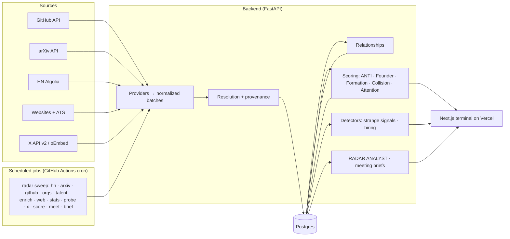

# ANTI RADAR

**Conviction Before Consensus.**

Technical founders rarely become obvious overnight. The signals appear first.

Anti Radar continuously analyzes technical activity across GitHub, research, hiring, the web and social sources to identify founders and companies whose underlying momentum is changing — before conventional startup databases catch up.

**[Live demo](#live-demo)** · **[Demo video](#demo-video)** · [Real-world evaluation](docs/REAL_WORLD_EVALUATION.md) · [Deployment](docs/DEPLOYMENT.md)


| | |
|---|---|
|  **Formation Radar** — technical teams before the company announcement. |  **Who should we meet this week?** — five people, ranked by evidence, not fame. |
|  **Why now** — the dated changes behind every recommendation. |  **People before companies** — verified technical history, formation signals, relationships. |
|  **Attention gap** — technical momentum vs measurable public attention. |  **Anti Brief** — source-cited research, facts and analysis kept apart. |

---

## Why Radar exists

Venture databases describe what already happened: funding rounds, press, headcount. The earliest signs of an important company show up somewhere else first:

- an engineer with years of commits to a frontier lab's codebase starts a new repository that people immediately use,
- two maintainers from rival open-source projects start committing to the same four-month-old GitHub organization,
- a research group ships a paper, releases code from a new org, and posts its first technical job,
- a robotics repo gains 1,700 stars in a month without a single Hacker News thread.

Each event alone is weak. Together, and dated, they become a reason to call someone this week. Radar turns that technical exhaust into a short, explainable research queue — and shows its work for every item in it.

The workflow it is built around:

```
DISCOVER  →  UNDERSTAND WHY NOW  →  INVESTIGATE  →  DECIDE WHO TO MEET  →  WATCH  →  CREATE BRIEF
```

## How it works

1. **Collect** — scheduled jobs pull public data from official APIs and websites (GitHub, arXiv, Hacker News, company sites and public job boards, X when an API key is configured). Every record keeps its source URL and observation time.
2. **Resolve** — deterministic entity resolution (domains, GitHub orgs, linked URLs). Uncertain matches become review candidates; nothing is merged silently. Same-name researchers are only merged on corroborating evidence.
3. **Relate** — a relationships table links people, organizations, repositories and papers: *co-authored with, contributed with, contributed to, member of, worked with (inferred)*. Every edge is VERIFIED or INFERRED and carries its evidence.
4. **Score** — deterministic, explainable scores. No language model sets a number.
5. **Surface** — the morning view, Formation Radar, the weekly meeting list, Daily Radar and a stored morning brief.
6. **Investigate** — on demand, the RADAR ANALYST agent writes a source-cited brief or meeting brief. External content is untrusted data, never instructions.

## Formation Radar

Formation Radar looks for people and teams *before* there is a company announcement. Candidates come from two directions:

- **Young organizations** — GitHub orgs created in the last 180 days in thesis areas with a working team (≥ 2 real contributors), enriched with their website, job boards, Hacker News threads and papers that link to their code.
- **A verified talent pool** — people with *verified* commits to frontier-lab and frontier-infrastructure repositories (Google DeepMind, OpenAI, NVIDIA, Meta, Physical Intelligence, vLLM, SGLang, PyTorch, Tenstorrent and others; see [`config/talent_sources.yaml`](config/talent_sources.yaml)), watched for new repositories with real traction, new young-org memberships, and clusters of lab alumni converging on the same project.

The **Formation Score (0–100)** is separate from ANTI SCORE and fully deterministic:

| Component | Max | Evidence |
|---|---:|---|
| Founder quality | 25 | members' Founder Scores and verified pedigree |
| Team convergence | 25 | prior relationships that *predate* the new org (co-authorship, co-contribution with commit dates, shared public org membership) |
| Technical activity | 20 | commits, stars, contributors, releases of the anchor — "insufficient history" when unmeasured |
| Formation evidence | 20 | org/repo created, first job posting, new site, launch, formation language, affiliation change — each a distinct dated item |
| Novelty / attention gap | 10 | first detection recency and measured attention gap |

Tiers: **HIGH CONFIDENCE** (≥ 70, ≥ 3 independent source families, convergence ≥ medium), **EMERGING** (≥ 50, ≥ 2 families), **EARLY SIGNAL** (≥ 30). Language stays honest: *possible formation*, *emerging team*, *formation signals detected* — nobody is called a founder without a founder relation on record. Every rejected anchor is logged with a reason (`python -m radar.scoring.formation --explain <org>`).

## Signal collision

A single signal can be noise. Independent signals around the same entity in a short window are much more interesting:

```
w_i      = confidence × strength × e^(−age / 21 d)          (42-day window)
F_family = 1 − Π(1 − w_i)                                    noisy-OR: repeats from one source saturate
raw      = Σ F_family × (1 + 0.5 · (k − 1))                  k = independent families present
raw     ×= 1.2 if the families landed within 14 days
C        = 1 − e^(−raw / 2)
```

Families: GitHub · Research · Hiring · Web · Community · Social. Measurements dated at observation time (e.g. "+400 stars in 30 days") are excluded — they already drive technical momentum. Output is human-readable: *"4 independent sources within 17 days — HIGH."*

## Attention gap

Technical momentum is compared with **measured** public attention (Hacker News points and mentions — probed directly, not inferred from absence — total stars, X followers when available):

```
TECHNICAL MOMENTUM 88 · PUBLIC ATTENTION 29 · ATTENTION GAP +59
```

Missing sources are listed ("social attention unavailable"), never imputed. If nothing was measured, no gap is awarded.

## Who should we meet?

Every week Radar picks about five **people**, not companies. The ranking favors verified technical history and a recent, traction-backed formation event over raw activity; unverified contributors are capped at WATCH; people whose company is already public or funded receive an obviousness penalty. Each pick shows why this person, why now, what changed, evidence count and confidence — and a one-click **meeting brief** (30-second context, what they've built, what changed, five questions worth asking, things to verify, sources). Citations are restricted to that person's own evidence.

## ANTI SCORE

ANTI SCORE (0–100) estimates how interesting a company is to Anti Fund *right now*. It supports the argument; it is not the argument — every page leads with **why now**.

| Component | Max | What it measures |
|---|---:|---|
| Technical momentum | 25 | percentiles of log-scaled 30-day velocity: stars, commits, forks, new contributors |
| Founder signal | 20 | Founder Scores of people with a founder relation |
| Acceleration | 20 | second derivative of stars/commits + signal collision |
| Thesis fit | 15 | theme match × stage preference × learned preference |
| Novelty | 10 | first detection + dissimilarity to what's already tracked |
| Attention gap | 10 | technical percentile − measured attention percentile |

Weights, thesis keywords, affiliation tiers and discovery queries live in [`config/anti_fund_thesis.yaml`](config/anti_fund_thesis.yaml). Analyst feedback (Interesting / Not interesting with reasons such as *too obvious, wrong thesis, strong founder*) adjusts bounded preference weights.

## Data sources

| Source | Access | What Radar uses |
|---|---|---|
| GitHub | REST API (token) | repos, star history, commits, contributors with dates, releases, issues/PRs, org creation, public org memberships, profiles (self-reported fields labeled as such) |
| arXiv | public API | papers, authors, code links |
| Hacker News | Algolia API | Show/Launch HN, discussions, direct attention probes |
| Websites & jobs | robots.txt-respecting crawl; Greenhouse / Lever / Ashby public APIs | positioning, formation language, hiring by technical role class |
| X | official API v2 only (`X_BEARER_TOKEN`) | discovery phrases, seed accounts. Without a key: **disabled**, plus manual paste-a-post ingestion via public oEmbed |

## System architecture



| Layer | Choice |
|---|---|
| Frontend | Next.js (App Router), TypeScript, Tailwind — server-side proxy keeps credentials off the client |
| API | FastAPI + SQLAlchemy 2 + Alembic |
| Database | Postgres (Neon in production) |
| Jobs | GitHub Actions cron calling `radar sweep`; `radar worker` (APScheduler) for local/Docker |
| LLM | provider abstraction (Anthropic first, OpenAI optional, none → deterministic templates); cached by content hash; daily spend cap |

## Trust & provenance

- **FACT / INFERENCE / ANALYSIS** are kept apart everywhere. Commit counts and dates are facts; a shared self-reported employer is inferred; model text is analysis.
- **VERIFIED / INFERRED / UNKNOWN** on every displayed fact. GitHub profile company and bio fields are labeled *self-reported*. Verified commits are never presented as employment.
- **Every claim links to its source** through a consistent source drawer; every entity shows **data age** per source family.
- **No fabricated history**: velocities say *insufficient history* when Radar hasn't observed enough; past scores are only compared like-for-like.
- **Automation is not people**: CI bots and AI coding agents (Claude, Copilot, Devin, Cursor…) are excluded from teams and rankings.
- **Prompt-injection defense**: scraped pages, READMEs and posts are wrapped as untrusted sources; citations are validated against what the agent actually saw.
- **Public deployments can't be polluted or run up a bill**: the snapshot backend refuses ingestion and runs with no LLM; on a live backend anything that writes or spends (ingest, investigate, briefs, watchlist, feedback) requires an admin token.

## Live demo

The public site runs on a **verified snapshot**: real public data collected by Radar on Oct 20, 2026, with every source URL and timestamp kept, so the demo is stable and every claim can be checked. `/demo` walks through the product in ten scenes. (An optional live backend, refreshed by scheduled jobs, deploys with `deploy.py --live`.)

Live URL: see [docs/DEPLOYMENT.md](docs/DEPLOYMENT.md#production-url).

## Demo video

A 2½-minute walkthrough recorded from `/demo` at 1920×1080 is attached to the latest [GitHub release](../../releases). Narration and shot list: [`demo/DEMO_SCRIPT.md`](demo/DEMO_SCRIPT.md), [`demo/DEMO_SHOT_LIST.md`](demo/DEMO_SHOT_LIST.md). Re-record with `cd e2e && ./record-demo.sh`.

## Run locally

```bash
cp .env.example .env            # everything optional; see comments
make db                         # Postgres in Docker
make migrate
cd backend && uv run radar seed-demo --reset   # load the committed verified snapshot
make api                        # FastAPI on :8000
make web                        # Next.js on :3000
make test                       # backend tests (real Postgres)
```

Or the whole stack: `make up` → http://localhost:3000.

Useful commands:

```bash
radar sweep                     # full live sweep (or --only github --only talent ...)
radar ingest github --repo owner/name
radar ingest url https://example.com
radar formation --explain <org> # why an anchor is or isn't a formation candidate
radar investigate "<name>"      # RADAR ANALYST → Anti Brief
radar status                    # provider health, volumes, LLM spend
radar demo capture              # collect a new verified snapshot
```

## Deployment

$0/month on free tiers: **Vercel** (frontend) · **Render** (API serving the verified snapshot) · **Neon** (Postgres). One command, three tokens: `cd backend && uv run python ../scripts/deploy.py`. Adding `--live` deploys a second API on live data with **GitHub Actions** running scheduled ingestion and scoring. Full instructions: [docs/DEPLOYMENT.md](docs/DEPLOYMENT.md).

## Limitations

Stated plainly, because an intelligence tool is only useful if you know where it's blind:

- **History is short.** Radar has only observed a few days; velocities beyond what GitHub's own history provides say *insufficient history*. Rankings improve every day the scheduled jobs run.
- **No X data without a paid API key.** Social attention is reported as unavailable, not zero.
- **No funding or press database.** "Already formed" is inferred from org age and self-descriptions; a funded company can still appear (see the evaluation's false positives).
- **GitHub statistics are sometimes still computing** (HTTP 202) for new repos; those gaps are retried, never filled with guesses.
- **arXiv author identity is name-based** and linked to GitHub only on corroborating evidence, so research history is under-counted.
- **Formation is about signals, not outcomes.** Most current candidates are honest *EARLY SIGNAL*s. See [docs/REAL_WORLD_EVALUATION.md](docs/REAL_WORLD_EVALUATION.md) for what the radar surfaced on real data, what was genuinely interesting, and what was wrong.
