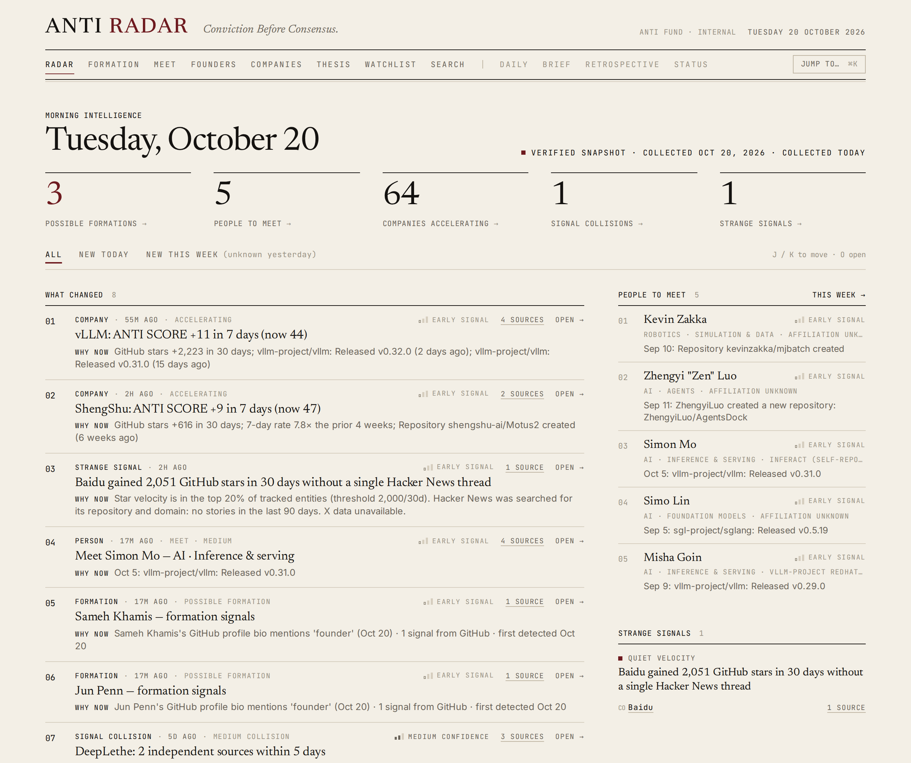
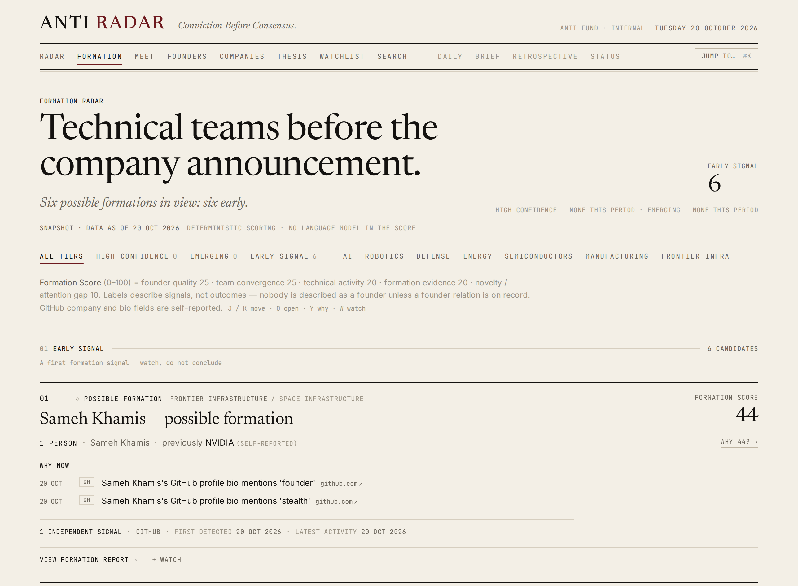
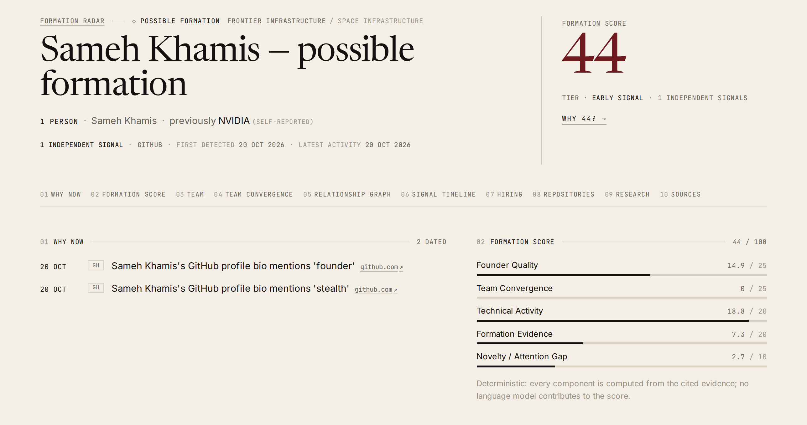
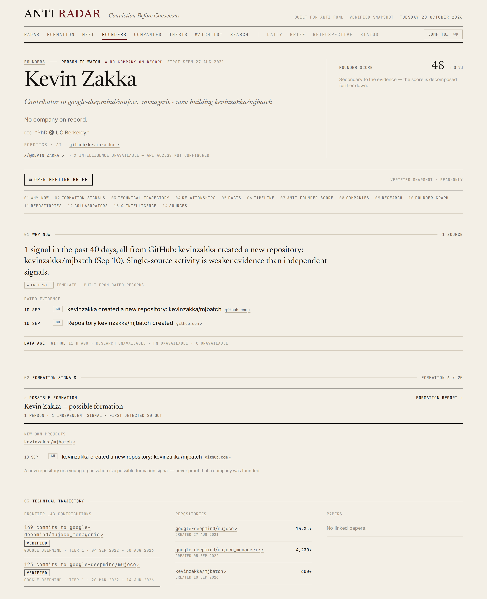
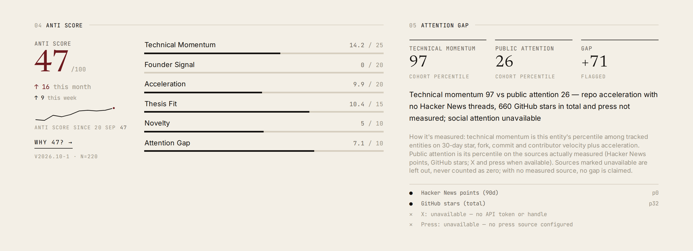
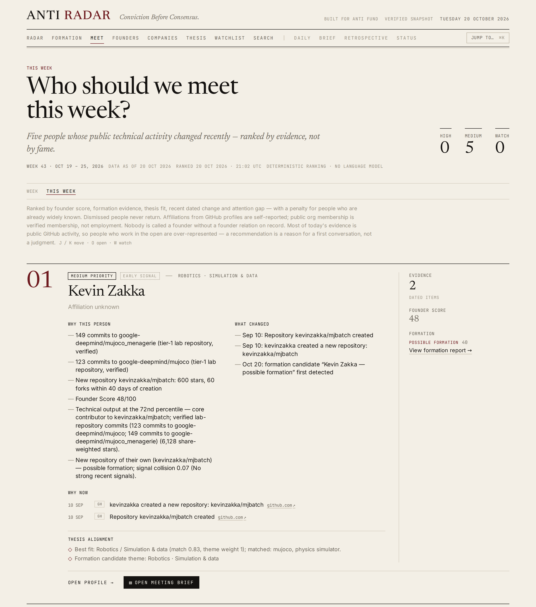
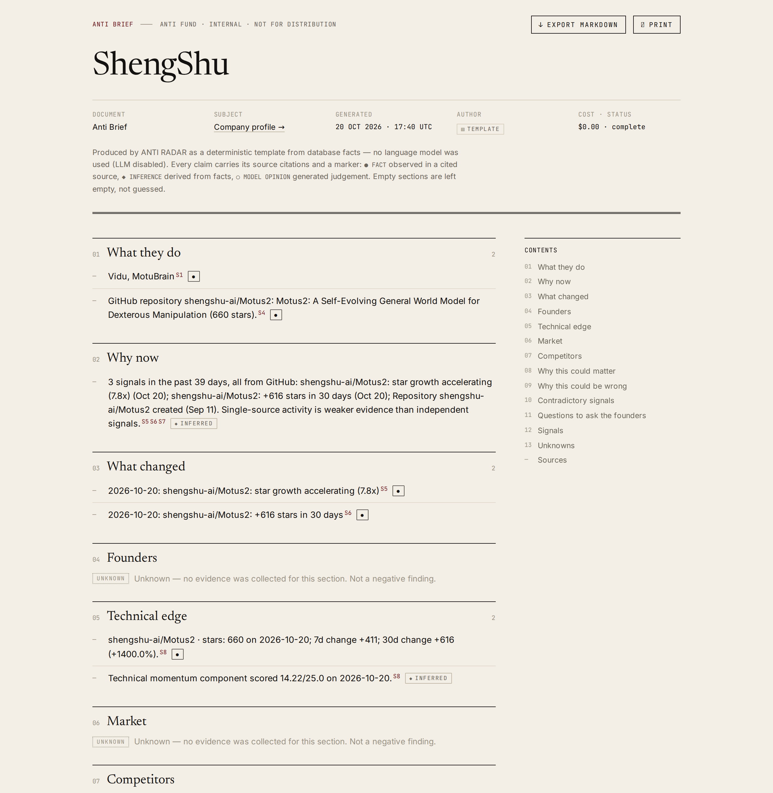
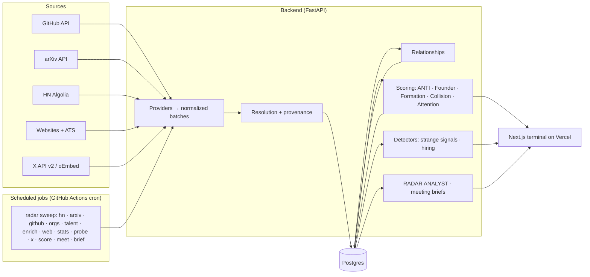

# ANTI RADAR

**Conviction Before Consensus.**

Technical founders rarely become obvious overnight. The signals appear first.

Anti Radar analyzes GitHub, research, hiring, the web and social signals to surface technical founders and companies whose underlying momentum is changing, before conventional startup databases catch up. Every claim it makes links to a public source.

### [▶ Watch the 3-minute demo](https://anti-radar-one.vercel.app/video) · [Open the radar](https://anti-radar-one.vercel.app) · [Guided tour](https://anti-radar-one.vercel.app/demo)

[](https://anti-radar-one.vercel.app)

The public site serves a **verified snapshot**: real public data collected on **Oct 20, 2026**, bundled with the site so it loads instantly and every number can be checked against its source. Anti Radar is an independent project built around Anti Fund's thesis; it is not affiliated with Anti Fund.

---

## Why I built this

Startup databases mostly describe companies that already exist: funding rounds, press, headcount. The earliest evidence that a technical company is forming shows up elsewhere: repositories, papers, research collaborations, technical releases, careers pages, hiring changes, and social activity.

Each of those is a weak signal on its own. Dated and combined, they can show technical momentum before consensus forms. Anti Radar collects them from official APIs, ties them to the people involved, scores them deterministically, and turns the result into a short list of people worth meeting this week, with the evidence for each one and an honest account of what it doesn't know.

## What it does

| | |
|---|---|
| **Formation Radar**: technical people and teams who may be converging before a company is announced. Labels stay honest: *possible formation*, never "founded". |  |
| **Why now**: the dated changes that made an entity surface, each linked to its source and marked fact or inference. |  |
| **Signal collision**: independent evidence from different source families (GitHub, research, hiring, web, community, social) landing within a short window. A single source is shown as exactly that. | *"1 independent signal, one source family (GitHub): not yet a collision."* |
| **People before companies**: verified technical history (commits to frontier-lab repositories), relationships and formation signals for each person. |  |
| **Attention gap**: technical momentum against measured public attention. Unmeasured sources (X, press) are shown as unavailable, never counted as zero. |  |
| **Who should we meet this week?**: sourcing turned into about five people to contact, each with why this person, why now, what changed, evidence and confidence. |  |
| **Anti Brief**: a source-cited research summary and a meeting brief per person. Unknowns stay unknown instead of being filled in. |  |

## Real-world evaluation

Anti Radar was run against real public data on Oct 20, 2026, and its output was reviewed by hand, with every evidence link checked. ([Full evaluation](docs/REAL_WORLD_EVALUATION.md))

| Analyzed | |
|---|---:|
| Companies and organizations | 200 |
| People (450 with verified commits to frontier-lab repositories) | 2,951 |
| Repositories | 303 |
| Research papers | 412 |
| Signals | 1,113 |

Manual review found real false positives, for example:
- side projects of researchers who are still employed;
- people surfaced mainly for heavy contributions to famous open-source repositories;
- co-founders whose company was already public;
- a young GitHub org whose tracked "members" were not its real core team;
- candidates whose formation evidence was a single bio line or a small research repo.

These were used to change the ranking: verified talent first, a penalty for already-public formations, noise filters and recorded rejection reasons. Remaining weak cases are listed rather than hidden. No prediction accuracy is claimed: formation is inference from public signals, not proof.

## Limitations

- **X coverage depends on API access.** Without a key, social attention is reported as unavailable, never as zero.
- **Formation is inference, not proof of company creation.** Most current candidates are honest *early signals*.
- **Hiring coverage varies.** Only companies with a public careers page or ATS board are covered; no formation candidate had job postings in this snapshot.
- **Public data has blind spots.** Private repositories, stealth hiring and funding are invisible. "Already formed" is inferred from org age and self-descriptions.
- **History is short.** Velocities strengthen as snapshots accumulate; until then they say *insufficient history*.
- **arXiv identity is name-based** and linked to GitHub only on corroborating evidence, so research history is under-counted.

## The demo

- **[Video](https://anti-radar-one.vercel.app/video)** (3:13, narrated, captioned). Also attached to the [v1.0.0 release](https://github.com/armaansingla14/Anti-Radar/releases/tag/v1.0.0). Script: [`demo/DEMO_SCRIPT.md`](demo/DEMO_SCRIPT.md). Shot list: [`demo/DEMO_SHOT_LIST.md`](demo/DEMO_SHOT_LIST.md).
- **[Guided tour](https://anti-radar-one.vercel.app/demo)**: the same ten scenes in the live app. Press → to advance.
- **[The radar](https://anti-radar-one.vercel.app)**: every page, all 220 companies and 2,804 people in the snapshot, served without a backend. The snapshot is read-only, so actions that write (watch, feedback, new investigations) run on a live backend.

## How it works

1. **Collect** — scheduled jobs pull public data from official APIs and websites (GitHub, arXiv, Hacker News, company sites and public job boards, X when an API key is configured). Every record keeps its source URL and observation time.
2. **Resolve** — deterministic entity resolution (domains, GitHub orgs, linked URLs). Uncertain matches become review candidates; nothing is merged silently. Same-name researchers are only merged on corroborating evidence.
3. **Relate** — a relationships table links people, organizations, repositories and papers: *co-authored with, contributed with, contributed to, member of, worked with (inferred)*. Every edge is VERIFIED or INFERRED and carries its evidence.
4. **Score** — deterministic, explainable scores. No language model sets a number.
5. **Surface** — the morning view, Formation Radar, the weekly meeting list, Daily Radar and a stored morning brief.
6. **Investigate** — on demand, the RADAR ANALYST agent writes a source-cited brief or meeting brief. External content is untrusted data, never instructions.

## Formation Radar

Formation Radar looks for people and teams *before* there is a company announcement. Candidates come from two directions:

- **Young organizations** — GitHub orgs created in the last 180 days in thesis areas with a working team (≥ 2 real contributors), enriched with their website, job boards, Hacker News threads and papers that link to their code.
- **A verified talent pool** — people with *verified* commits to frontier-lab and frontier-infrastructure repositories (Google DeepMind, OpenAI, NVIDIA, Meta, Physical Intelligence, vLLM, SGLang, PyTorch, Tenstorrent and others; see [`config/talent_sources.yaml`](config/talent_sources.yaml)), watched for new repositories with real traction, new young-org memberships, and clusters of lab alumni converging on the same project.

The **Formation Score (0–100)** is separate from ANTI SCORE and fully deterministic:

| Component | Max | Evidence |
|---|---:|---|
| Founder quality | 25 | members' Founder Scores and verified pedigree |
| Team convergence | 25 | prior relationships that *predate* the new org (co-authorship, co-contribution with commit dates, shared public org membership) |
| Technical activity | 20 | commits, stars, contributors, releases of the anchor — "insufficient history" when unmeasured |
| Formation evidence | 20 | org/repo created, first job posting, new site, launch, formation language, affiliation change — each a distinct dated item |
| Novelty / attention gap | 10 | first detection recency and measured attention gap |

Tiers: **HIGH CONFIDENCE** (≥ 70, ≥ 3 independent source families, convergence ≥ medium), **EMERGING** (≥ 50, ≥ 2 families), **EARLY SIGNAL** (≥ 30). Language stays honest: *possible formation*, *emerging team*, *formation signals detected* — nobody is called a founder without a founder relation on record. Every rejected anchor is logged with a reason (`python -m radar.scoring.formation --explain <org>`).

## Signal collision

A single signal can be noise. Independent signals around the same entity in a short window are much more interesting:

```
w_i      = confidence × strength × e^(−age / 21 d)          (42-day window)
F_family = 1 − Π(1 − w_i)                                    noisy-OR: repeats from one source saturate
raw      = Σ F_family × (1 + 0.5 · (k − 1))                  k = independent families present
raw     ×= 1.2 if the families landed within 14 days
C        = 1 − e^(−raw / 2)
```

Families: GitHub · Research · Hiring · Web · Community · Social. Measurements dated at observation time (e.g. "+400 stars in 30 days") are excluded — they already drive technical momentum. Output is human-readable: *"4 independent sources within 17 days — HIGH."*

## Attention gap

Technical momentum is compared with **measured** public attention (Hacker News points and mentions — probed directly, not inferred from absence — total stars, X followers when available):

```
TECHNICAL MOMENTUM 97 · PUBLIC ATTENTION 26 · ATTENTION GAP +71     (ShengShu, verified snapshot)
```

Missing sources are listed ("social attention unavailable"), never imputed. If nothing was measured, no gap is awarded.

## Who should we meet?

Every week Radar picks about five **people**, not companies. The ranking favors verified technical history and a recent, traction-backed formation event over raw activity; unverified contributors are capped at WATCH; people whose company is already public or funded receive an obviousness penalty. Each pick shows why this person, why now, what changed, evidence count and confidence — and a one-click **meeting brief** (30-second context, what they've built, what changed, five questions worth asking, things to verify, sources). Citations are restricted to that person's own evidence.

## ANTI SCORE

ANTI SCORE (0–100) estimates how interesting a company is to Anti Fund *right now*. It supports the argument; it is not the argument — every page leads with **why now**.

| Component | Max | What it measures |
|---|---:|---|
| Technical momentum | 25 | percentiles of log-scaled 30-day velocity: stars, commits, forks, new contributors |
| Founder signal | 20 | Founder Scores of people with a founder relation |
| Acceleration | 20 | second derivative of stars/commits + signal collision |
| Thesis fit | 15 | theme match × stage preference × learned preference |
| Novelty | 10 | first detection + dissimilarity to what's already tracked |
| Attention gap | 10 | technical percentile − measured attention percentile |

Weights, thesis keywords, affiliation tiers and discovery queries live in [`config/anti_fund_thesis.yaml`](config/anti_fund_thesis.yaml). Analyst feedback (Interesting / Not interesting with reasons such as *too obvious, wrong thesis, strong founder*) adjusts bounded preference weights.

## Data sources

| Source | Access | What Radar uses |
|---|---|---|
| GitHub | REST API (token) | repos, star history, commits, contributors with dates, releases, issues/PRs, org creation, public org memberships, profiles (self-reported fields labeled as such) |
| arXiv | public API | papers, authors, code links |
| Hacker News | Algolia API | Show/Launch HN, discussions, direct attention probes |
| Websites & jobs | robots.txt-respecting crawl; Greenhouse / Lever / Ashby public APIs | positioning, formation language, hiring by technical role class |
| X | official API v2 only (`X_BEARER_TOKEN`) | discovery phrases, seed accounts. Without a key: **disabled**, plus manual paste-a-post ingestion via public oEmbed |

## System architecture



| Layer | Choice |
|---|---|
| Frontend | Next.js (App Router), TypeScript, Tailwind — server-side proxy keeps credentials off the client |
| API | FastAPI + SQLAlchemy 2 + Alembic |
| Database | Postgres (Neon in production) |
| Jobs | GitHub Actions cron calling `radar sweep`; `radar worker` (APScheduler) for local/Docker |
| LLM | provider abstraction (Anthropic first, OpenAI optional, none → deterministic templates); cached by content hash; daily spend cap |

## Trust & provenance

- **FACT / INFERENCE / ANALYSIS** are kept apart everywhere. Commit counts and dates are facts; a shared self-reported employer is inferred; model text is analysis.
- **VERIFIED / INFERRED / UNKNOWN** on every displayed fact. GitHub profile company and bio fields are labeled *self-reported*. Verified commits are never presented as employment.
- **Every claim links to its source** through a consistent source drawer; every entity shows **data age** per source family.
- **No fabricated history**: velocities say *insufficient history* when Radar hasn't observed enough; past scores are only compared like-for-like.
- **Automation is not people**: CI bots and AI coding agents (Claude, Copilot, Devin, Cursor…) are excluded from teams and rankings.
- **Prompt-injection defense**: scraped pages, READMEs and posts are wrapped as untrusted sources; citations are validated against what the agent actually saw.
- **The public site can't be polluted or run up a bill**: it serves a read-only verified snapshot with no backend and no LLM. On a live backend, anything that writes or spends (ingest, investigate, briefs, watchlist, feedback) requires an admin token.

## Run locally

```bash
cp .env.example .env            # everything optional; see comments
make db                         # Postgres in Docker
make migrate
cd backend && uv run radar seed-demo --reset   # load the committed verified snapshot
make api                        # FastAPI on :8000
make web                        # Next.js on :3000
make test                       # backend tests (real Postgres)
```

Or the whole stack: `make up` → http://localhost:3000. To serve the bundled snapshot with no backend at all: `cd frontend && DATA_SOURCE=snapshot npx next build && DATA_SOURCE=snapshot npx next start`.

Useful commands:

```bash
radar sweep                     # full live sweep (or --only github --only talent ...)
radar ingest github --repo owner/name
radar ingest url https://example.com
radar formation --explain <org> # why an anchor is or isn't a formation candidate
radar investigate "<name>"      # RADAR ANALYST → Anti Brief
radar status                    # provider health, volumes, LLM spend
radar demo capture              # collect a new verified snapshot
```

## Deployment

- **Cost:** $0/month on free tiers.
- **How it's served:** the public site runs on **Vercel** and serves the bundled verified snapshot (`DATA_SOURCE=snapshot`), so no page waits on a backend.
- **Live backend:** the FastAPI service is optional. It runs on **Render** with **Neon** Postgres and **GitHub Actions** for scheduled ingestion, deployed with `scripts/deploy.py --live`. In that mode the site reads live data and falls back to the snapshot if the backend doesn't answer.
- **Before sending the link:** `node scripts/verify_public_demo.mjs` checks the public deployment end to end.
- **Full instructions:** [docs/DEPLOYMENT.md](docs/DEPLOYMENT.md).
